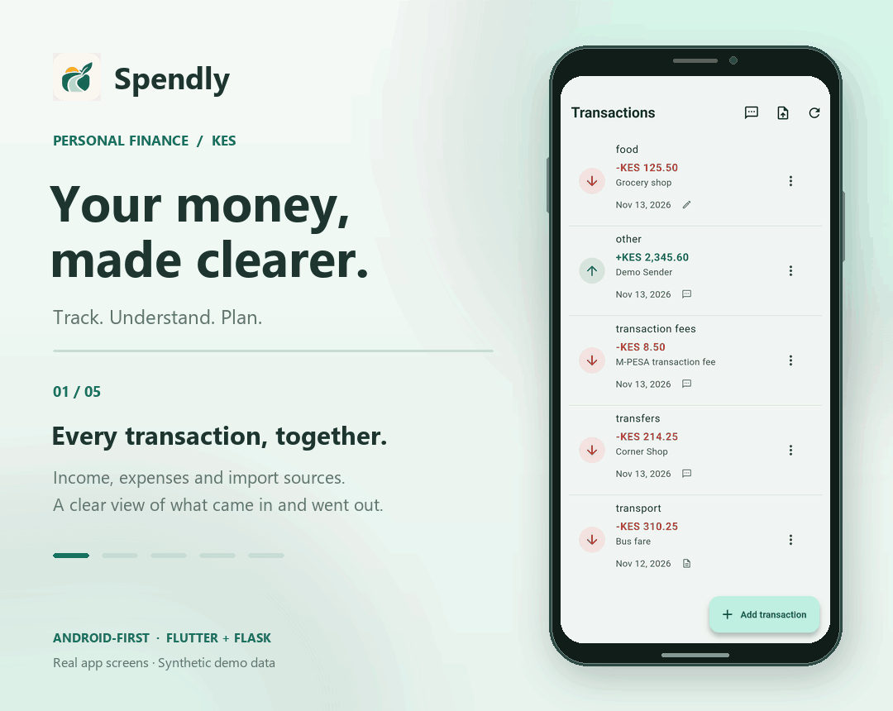
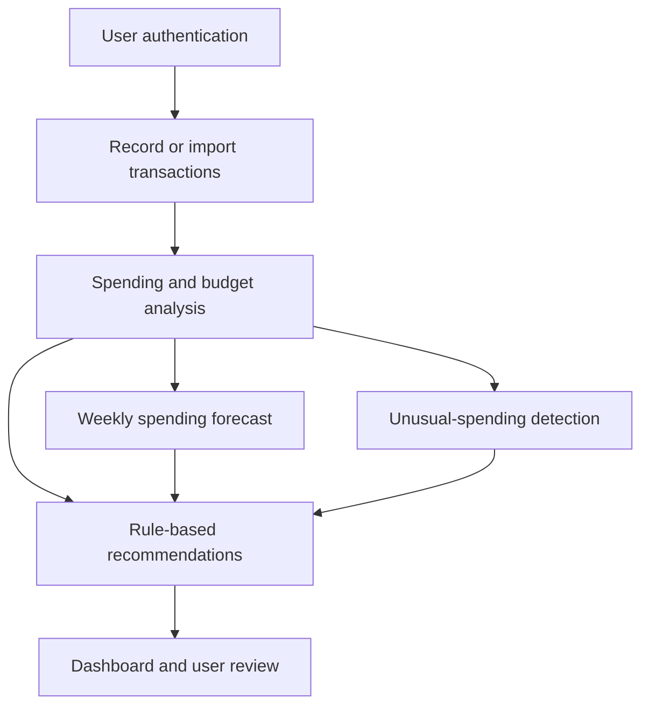
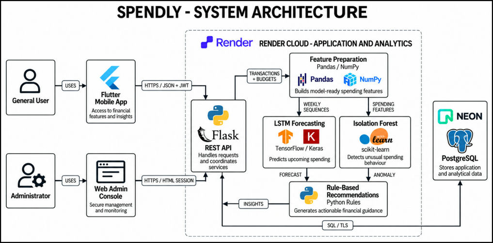
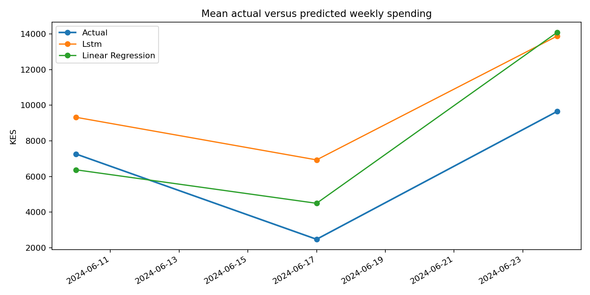
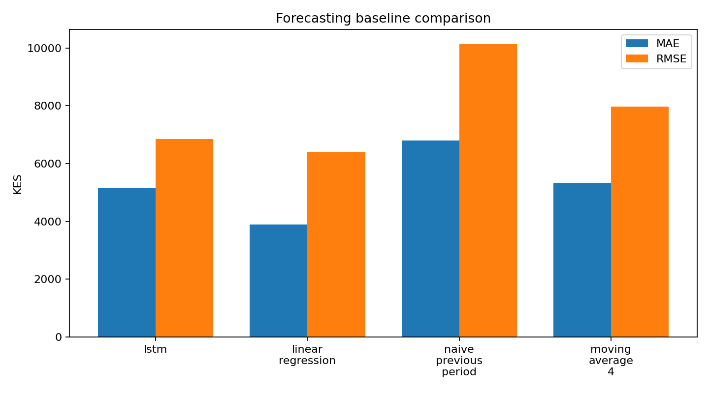

<p align="center">
  
</p>

# Spendly

**Personal Finance Decision Support for Kenyan Young Adults**

Spendly is an Android-first Flutter and Flask application for tracking money in
Kenyan shillings (KES), understanding spending patterns and planning budgets.
It combines financial records with weekly spending estimates, unusual-spending
alerts and explainable, rule-based guidance.


[](https://github.com/Eeshan-Vaghjiani/Spendly/releases/download/v1.4.1/Spendly-1.4.1-15.apk)

[All Releases](https://github.com/Eeshan-Vaghjiani/Spendly/releases)
· [Installation Guide](docs/INSTALLATION_AND_REPRODUCIBILITY.md)
· [Documentation](#documentation)

## App Preview

<picture>
  <source media="(prefers-reduced-motion: reduce)" srcset="docs/media/spendly-preview.png">
  
</picture>

[Save the GIF](docs/media/spendly-preview.gif)

Genuine Flutter screenshots with **fictional demonstration data**, presented as a
phone-frame screenshot slideshow, not a live recording of taps. Captured in a
separate acceptance build, distinct from the original downloadable APK.
[Preview provenance and limitations](docs/media/README.md).

## Explore Spendly

[Features](#main-features) · [How It Works](#how-spendly-works) · [Architecture](#system-architecture) ·
[ML Results](#machine-learning-and-evaluation) · [Technology](#technology-stack) ·
[Download](#download-spendly) · [Installation](#installation-and-reproducibility) ·
[Documentation](#documentation) · [Security and Limitations](#security-privacy-and-limitations) ·
[Contributing](#community-and-contributions)

## Project Overview

Spendly is a final-year Computer Science project connecting an Android client,
authenticated REST services, relational data and evaluated machine-learning
components. Users remain in control: the app explains recorded spending and
suggests what to review; it does not move money or execute financial decisions.

The application and its academic evidence are available for assessment and
development. **Forecasts are estimates, alerts are not fraud findings, and
recommendations are not professional financial advice.** Synthetic-data results
do not establish performance for real Kenyan users.

## Main Features

| Area | What Spendly supports |
|---|---|
| Accounts | Registration, password/Google sign-in, editable usernames and account-scoped onboarding |
| Transactions | Income and expenses, categories, transaction management and CSV import |
| Dashboard | KES summaries, cash flow, period filters and financial history |
| Budgets | Budget creation, recorded spending and category-level review |
| Forecasts | Weekly LSTM spending estimates when sufficient confirmed history is available |
| Alerts and guidance | Reviewable unusual-spending alerts, analysis history and deterministic recommendations |
| Administration | Separate audited console for account access, record corrections, exports/deletion and insight controls |

Optional M-PESA SMS import has separate capability, permission and consent gates.
It is not required for manual/CSV use. See the
[SMS contract](docs/mpesa_sms_import.md), [account/API behavior](docs/api_guide.md)
and [administrator safeguards](docs/admin_management.md).

## How Spendly Works



Recorded income, expenses and budgets provide the context. Available forecasts
and alerts inform recommendations, which the user reviews voluntarily. If forecast
history is insufficient, supported partial analysis can still return alerts and
eligible record-based guidance. **Training happens separately; API requests run
inference on retained models.**

## System Architecture

<a href="docs/media/system-architecture.jpg"></a>

*Select the diagram to view it at full resolution. TensorFlow/Keras identifies
the model-development stack; the selected serving runtime is described below.*

Flutter calls the API through repository/API-client boundaries. Flask validates
requests, enforces authenticated ownership and persists records and analysis
outputs through SQLAlchemy. The administrator console uses a separate privileged
session boundary.

Runtime selection is configuration-dependent. The selected V6 path serves a
portable LSTM and retained Isolation Forest without TensorFlow or Linear Regression
at inference time; legacy V1 artifacts remain a separate path. Research candidates
are not automatically deployed. [Detailed architecture](docs/system_architecture.md)
· [API guide](docs/api_guide.md).

## Machine Learning and Evaluation

**Evidence is grouped by model, dataset and protocol.** The July controlled study,
later R3 research and Wasaa transfer experiment are different evaluations, not a
single leaderboard or a measurement of the currently hosted service.

### Spending Forecasting

The LSTM estimates weekly expense outflow from spending history. The selected
runtime targets the **current Nairobi Monday–Sunday week using eight complete
preceding weeks**, with explicit history-completeness confirmation. Missing history
is not filled with a fabricated zero forecast.

**Historical controlled comparison — 25 July 2026.** All four methods used the
same 900 chronological weekly test targets from synthetic data.

| Model | Test MAE (KES), lower is better |
|---|---:|
| Linear Regression | **3,895.09** |
| LSTM | 5,156.72 |
| Four-period moving average | 5,344.96 |
| Previous-period naive | 6,798.63 |

The LSTM remained the project's main forecasting approach, but **Linear Regression
had the lowest MAE in this experiment**. The roughly 180-day, 300-simulated-user
dataset has only three unique weekly test dates; it cannot establish long-term
seasonality or real-user accuracy.
[Comparison and limitations](reports/forecasting_model_comparison.md)
· [Historical V1 model card](docs/model_card_lstm.md).

<a href="reports/figures/actual_vs_predicted_spending.png"></a>

*Actual vs predicted spending: means across users at each of the three test dates,
not an individual user's forecast trace.*

<a href="reports/figures/forecasting_baseline_comparison.png"></a>

*Original July MAE/RMSE comparison for the same targets.
[Figure-generation source](models/training/train_forecasting_models.py).*

<details>
<summary>Later R3 validation and Wasaa transfer — separate evidence</summary>

| Retained total-spending LSTM evaluation | WAPE | MAE (KES) | R² |
|---|---:|---:|---:|
| R3 reused validation, V9 retained V6 export | 34.52% | 2,616.88 | 0.4163 |
| Wasaa frozen transfer, consumption scenario | 75.28% | 11,906.71 | −0.5988 |

The R3 row is **reused validation, not an untouched final test**. V7/V8/V9
candidates did not meet promotion criteria; the V6 reference was retained.
[V9 results](model_research/V9_RESULTS.md).

Wasaa used 500 synthetic households and 6,000 household-week targets per scenario,
without refitting weights, scalers or thresholds. Transfer was poor; the category
LSTM failed severely and was not adopted. Later Wasaa-trained notebooks use a
different snapshot/protocol and are not these frozen-transfer results.
[Transfer report](model_research/WASAA_TRANSFER_RESULTS.md)
· [Pilot model-retention decision](docs/wasaa_testing_and_model_decision.md).

</details>

### Unusual-Spending Detection

Isolation Forest flags spending patterns that differ from recorded history.
**Final R3 results** concern the frozen single excess-view forest (300 trees,
seed 42), with its threshold fixed before evaluation on independent synthetic
users. The historical V1 row is included only as separately labelled context.

| Evaluation | Scored rows | Precision | Recall | F1 |
|---|---:|---:|---:|---:|
| Final R3 standard test | 32,841 | 62.32% | 71.39% | 0.6655 |
| Final R3 shifted robustness test | 32,599 | 54.73% | 69.95% | 0.6141 |
| Historical July V1 controlled test | 13,877 | 16.34% | 13.74% | 0.1493 |

Sources: [final model, protocol and results](model_research/IF_SUBMISSION_RESULTS.md),
[July evaluation](reports/isolation_forest_evaluation.md) and
[historical V1 model card](docs/model_card_isolation_forest.md).

The final model did not meet the historical 80% precision/recall/F1 aspiration.
Recurring increases and split events remain weaknesses; precision degrades under
the shifted protocol. These controlled labels do not prove real-world detection
quality or fraud.

On the **unlabelled Wasaa transfer snapshot**, the frozen forest raised 46 alerts
from 39,679 transactions (0.1159%). Precision, recall and F1 are **unavailable**:
an alert rate is not detection accuracy.
[Wasaa evidence](model_research/WASAA_TRANSFER_RESULTS.md#isolation-forest).

### Rule-Based Recommendations

The Python engine applies **deterministic rules**, not a separate trained language
model. It combines recorded expenses/income, budgets, summaries, available forecasts
and alert-review context. Supported guidance includes spending above income,
forecast above budget, unusual-entry review, category/recurring/frequency/overall growth,
stable-within-budget feedback and planning around confirmed intentional spending.

Suggestions explain their supporting values and leave decisions to the user.
[Rules](services/recommendation_engine/rules.py)
· [Availability and partial-analysis behavior](docs/api_guide.md#main-workflow).

## Technology Stack

| Layer | Technologies |
|---|---|
| Android client | Flutter, Dart, Riverpod |
| Backend and API | Python, Flask, REST/JSON |
| Persistence | SQLAlchemy, Alembic; PostgreSQL pilot and local MySQL Compose setup |
| Forecasting | LSTM; TensorFlow/Keras for training/research, NumPy-based selected portable serving |
| Unusual-spending detection | scikit-learn Isolation Forest; retained portable inference |
| Recommendations | Python deterministic rule engine |
| Testing | pytest, Flutter widget/unit tests and separate native integration suites |
| Version control and distribution | Git, GitHub, GitHub Releases |

## Download Spendly

**Latest public Android release: v1.4.1 (build 15)**, published 14 November 2026.
Public release metadata, APK bytes and checksum verified on **16 November 2026**.

[](https://github.com/Eeshan-Vaghjiani/Spendly/releases/download/v1.4.1/Spendly-1.4.1-15.apk)

**Other options**

[](https://github.com/Eeshan-Vaghjiani/Spendly/releases/download/v1.4.1/Spendly-1.4.1-15.sha256) [](https://github.com/Eeshan-Vaghjiani/Spendly/releases)

[v1.4.1 release notes](https://github.com/Eeshan-Vaghjiani/Spendly/releases/tag/v1.4.1)
· [Published release inventory](docs/releases/PUBLISHED_RELEASES.md)

Requires **Android 7.0 / API 24+**, ARM32, ARM64 or x86_64, internet access and a
compatible backend/account. These educational APKs use an **Android Debug signing
certificate**; they are not Play-certified or production-signed. Older releases
are **unsupported archives** and may lack later financial/authentication fixes.

Verify SHA256 before installation. Keep Play Protect enabled and stop on harmful-app
or sensitive-data blocking warnings. Do not uninstall, clear data, force a downgrade
or resign an archive to bypass a conflict. Prefer fictional demonstration records
and leave optional SMS/training off unless separately authorised.
[Installation and non-destructive troubleshooting](docs/INSTALLATION_AND_REPRODUCIBILITY.md).
GitHub's Latest label does not certify backend availability or device acceptance.

## Installation and Reproducibility

- **Use the existing APK:** follow the [installation guide](docs/INSTALLATION_AND_REPRODUCIBILITY.md#a-install-the-ready-made-android-prototype).
- **Reproduce the recorded source:** use the [Windows/Python/Flutter/PostgreSQL procedure](docs/INSTALLATION_AND_REPRODUCIBILITY.md#b-reproduce-the-source-on-windows), pinned to the original APK source revision.
- **Develop on current main:** start with [contributor setup](CONTRIBUTING.md#development-setup) and the [development reference](README_DEVELOPMENT.md).

Use an isolated environment and a disposable local database. Compose persists
MySQL data and applies migrations at startup; verify the target first. Retained
models are already trained. Rebuilding current source does not reproduce the
original signed APK or update its hosted backend.

## Project Structure

| Path | Purpose |
|---|---|
| [`mobile/`](mobile/) | Flutter Android client and tests |
| [`backend/`](backend/) | Flask API, administrator console, migrations and tests |
| [`services/`](services/) | Aligned inference and recommendation engine |
| [`artifacts/`](artifacts/) | Versioned V1 models and retained selected bundles |
| [`models/training/`](models/training/) | Historical controlled training/evaluation code |
| [`model_research/`](model_research/) | Research protocols, experiments and aggregate evidence |
| [`reports/`](reports/) | Controlled evaluation reports and original figures |
| [`docs/`](docs/) | Architecture, privacy, acceptance, installation and academic documentation |

## Testing

From the repository root, using the isolated Python environment described in
[CONTRIBUTING.md](CONTRIBUTING.md#quality-and-testing):

```powershell
python -m pytest backend/tests services/recommendation_engine/tests --ignore=backend/tests/test_model_inference.py --ignore=backend/tests/test_vertical_slice_real.py -q
```

From `mobile/`, after dependency resolution, run serially:

```powershell
flutter analyze --no-pub
flutter test --no-pub
```

Ordinary backend fixtures use SQLite and fake inference with V1 schemas;
selected-registry tests additionally exercise the retained portable bundle.
The two excluded legacy real-model suites have separate prerequisites.
The opt-in live Flutter test creates records and needs an explicitly approved
disposable backend. Widget tests do not establish native OAuth, SMS, physical-device
or production-database acceptance. See [dated acceptance evidence](docs/acceptance_status.md)
and [showcase verification](docs/evidence/readme_showcase_2026_11_16.md).

## Documentation

| Start here | References |
|---|---|
| Understand the application | [Architecture](docs/system_architecture.md) · [API](docs/api_guide.md) · [OpenAPI](docs/openapi.yaml) |
| Install and assess | [Installation](docs/INSTALLATION_AND_REPRODUCIBILITY.md) · [Release identity](docs/release_1_4_1.md) · [APK verification](docs/evidence/apk_release_verification_2026_11_12.md) |
| Review delivery evidence | [Acceptance matrix](docs/acceptance_status.md) · [Issue dispositions](docs/evidence/issue_closeout_2026_11_07.md) |
| Academic submission | [Report draft](docs/submission_report.md) · [Requirements/evidence matrix](docs/submission_evidence.md) · [Wasaa decision](docs/wasaa_testing_and_model_decision.md) |
| Configure optional capabilities | [Google Sign-In](docs/google_sign_in_setup.md) · [M-PESA consent](docs/mpesa_sms_import.md) · [Admin controls](docs/admin_management.md) |
| Review model boundaries | [Final IF evidence](model_research/IF_SUBMISSION_RESULTS.md) · [V2 integration readiness](docs/model_integration_readiness_v2.md) |

Dated records retain the versions and limitations they evaluated. The original
[release preparation record](docs/releases/Spendly-1.4.1-15.md) remains historical;
its draft-only wording is superseded by the public release.

## Deployment Status

The recorded pilot uses a separately managed Flask service and PostgreSQL database.
**GitHub source, backend deployment and Android APK distribution are separate
deliverables.** A README/source merge neither updates the original APK nor deploys
the service, applies migrations or enables SMS.

Current hosted configuration, uptime and historical-client compatibility were not
revalidated for this showcase. Deployment remains a separate owner-approved action:
[branch workflow](docs/git_workflow.md),
[deployment guide](docs/live_deployment_and_tester_apk.md) and
[recorded 1.4.1 rollout/migrations](docs/release_1_4_1.md).

## Security, Privacy and Limitations

- Financial record ownership comes from authenticated identity. Mobile JWTs and
  privileged administrator sessions have separate boundaries.
- Service/privacy acceptance, SMS consent and optional training opt-in are distinct.
  User financial records are **not automatically used for training**.
- Use synthetic data in demonstrations. Never publish credentials, tokens, private
  transaction/SMS records, connection strings or signing material.
- Forecasts depend on complete history and may be inaccurate. Alerts require human
  review; rule suggestions are not professional advice or proof of savings.
- Synthetic experiments, passing tests and public APK availability do not establish
  real-user accuracy, complete device compatibility, privacy approval or production
  certification.

[Security and privacy](docs/security_and_privacy.md) ·
[Project limitations](docs/limitations.md) · [Admin safeguards](docs/admin_management.md) ·
[Report a vulnerability privately](SECURITY.md).

## Community and Contributions

Created by **Eeshan Vaghjiani** as a final-year Computer Science project.
Contributions follow the reviewed branch → PR → `main` workflow.

[Contributing](CONTRIBUTING.md) · [Code of Conduct](CODE_OF_CONDUCT.md) ·
[Accessibility](ACCESSIBILITY.md) · [Security Policy](SECURITY.md) ·
[Bug reports](.github/ISSUE_TEMPLATE/bug_report.md) ·
[Feature requests](.github/ISSUE_TEMPLATE/feature_request.md) ·
[PR template](.github/PULL_REQUEST_TEMPLATE.md).

[Existing-brand assets and Android listing draft](docs/store-assets/README.md) ·
[Community setup and pending owner decisions](docs/community_setup.md).

## License

Copyright © 2026 Eeshan Vaghjiani. Spendly's original application code is licensed
under the [MIT License](LICENSE). Third-party dependencies, datasets and assets
retain their respective licences and permissions.
