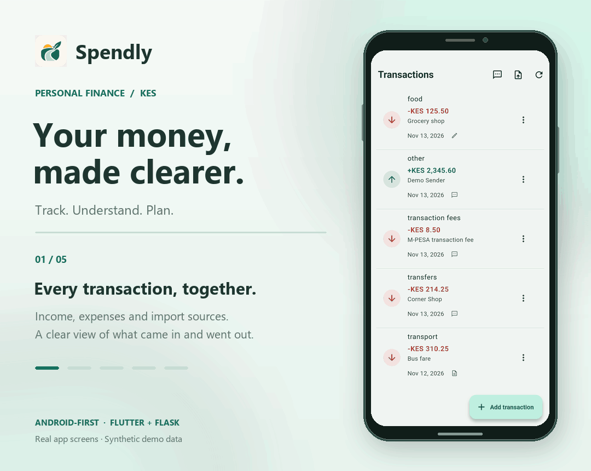

# Spendly

Spendly is an Android-first personal-finance decision-support application for
Kenyan young adults, built with Flutter and Flask. It helps users track money in
Kenyan shillings (KES), understand spending patterns, and plan their budgets.

## App preview

<picture>
  <source media="(prefers-reduced-motion: reduce)" srcset="docs/media/spendly-preview.png">
  
</picture>

[View the still image](docs/media/spendly-preview.png) · [Save the GIF](docs/media/spendly-preview.gif)

Actual app screenshots with fictional demonstration data, presented as a
phone-frame slideshow—not a live recording. Captured in a separate acceptance
build; [preview provenance and limitations](docs/media/README.md).

## Main features

- Income and expense tracking, manual transaction entry, and CSV uploads.
- Budgets, category summaries, and cash-flow analytics.
- Weekly spending forecasts from recorded history and versioned model runtimes.
- Isolation Forest-based unusual-spending detection and alerts for review.
- Rule-based recommendations informed by spending, budgets, and analysis results.
- Authenticated account access and a separate administrator management console.

Forecasts are estimates, unusual-spending alerts are not fraud findings, and
recommendations are not professional financial advice. This is an academic/pilot
project; synthetic-data research results do not establish accuracy for real users.

## Download Spendly

**Latest: Spendly 1.4.1 (Build 15)** — published on 14 November 2026.


## Download Spendly

**Spendly for Android**

Latest Release: **v1.4.1 (Build 15)**

### Download Application

[](https://github.com/Eeshan-Vaghjiani/Spendly/releases/download/v1.4.1/Spendly-1.4.1-15.apk)

**Other options**

[](https://github.com/Eeshan-Vaghjiani/Spendly/releases/download/v1.4.1/Spendly-1.4.1-15.sha256) [](https://github.com/Eeshan-Vaghjiani/Spendly/releases)


Requires **Android 7.0 / API 24 or later**, on ARM32, ARM64 or x86_64.
The APKs are educational prototypes signed with the **Android Debug certificate**,
not Play-certified production packages. Older versions are unsupported archives
and may lack later financial/auth fixes. GitHub's Latest designation supports
discovery; it does not certify backend availability, historical-client
compatibility, privacy/SMS approval or device acceptance.

Check the companion SHA256 before installing. Keep Play Protect enabled and stop
on harmful-app or sensitive-data blocking warnings. Do not uninstall, clear data,
force a downgrade or resign an archive to bypass an update conflict. Use fictional
demonstration records; leave optional SMS import/training OFF unless separately
authorised. The matching backend and an authorised account are required.

## Architecture

The Flutter client uses Riverpod state and repository/API-client boundaries to
call the Flask JSON API at `/api/v1`. Flask handles validation, authenticated
record ownership, persistence, inference, and recommendation rules. SQLAlchemy
supports the PostgreSQL pilot database and the local MySQL Compose setup.
Model training is separate from API requests. The chosen model/runtime and
available history determine forecast behavior; research candidates are not
automatically deployed. See the [architecture guide](docs/system_architecture.md)
and [API guide](docs/api_guide.md) for context.

## Repository layout

Submission documentation: [report draft](docs/submission_report.md),
[requirements and evidence matrix](docs/submission_evidence.md), and
[Wasaa testing decision](docs/wasaa_testing_and_model_decision.md).
Historical evidence distinguishes its tested source/binary from the deployed
release. Current work goes through reviewed PRs to `main`; deployment remains a
separate owner-approved action. See [the branch workflow](docs/git_workflow.md).

Current delivery and remaining work: [acceptance status](docs/acceptance_status.md)
and [7 November issue dispositions](docs/evidence/issue_closeout_2026_11_07.md).
Completed comparisons and out-of-scope proposals are distinguished from outstanding
device, privacy, and institutional acceptance; closing a proposal is not a test pass.

- `mobile/` — Flutter Android client.
- `backend/` — Flask API, migrations and administrator dashboard.
- `services/recommendation_engine/` — rule-based financial recommendations.
- `artifacts/models/` — versioned production model artifacts.
- `model_research/` — forecasting experiments, Kaggle notebooks, and research results.
- `docs/` — architecture, security, academic evidence, and release guidance.
- `render.yaml` — Render Blueprint for the live lightweight deployment.

## Examiner installation and reproducibility

- [Install the verified Android APK or reproduce the source on Windows](docs/INSTALLATION_AND_REPRODUCIBILITY.md).
- [Recorded private API 1.4.1 / Android 1.4.1+15 release](docs/release_1_4_1.md) and [fresh APK integrity verification](docs/evidence/apk_release_verification_2026_11_12.md).
- [Application test/acceptance evidence](docs/acceptance_status.md) and [model evaluation and limitations](docs/wasaa_testing_and_model_decision.md).
- [Published v1.4.1 release and original APK assets](https://github.com/Eeshan-Vaghjiani/Spendly/releases/tag/v1.4.1). The [original preparation record](docs/releases/Spendly-1.4.1-15.md) remains in source as historical evidence; its draft-only wording is superseded by the published release.

The original APK is separate from later main changes. Public artifact distribution
does not deploy a service or establish complete physical-device compatibility;
use synthetic demonstration data and read the release's remaining limitations.

## Setup and local verification

Start with the [contribution setup guide](CONTRIBUTING.md#development-setup) for
Python/Flutter prerequisites, an isolated test environment, and local backend
configuration. [README_DEVELOPMENT.md](README_DEVELOPMENT.md) and
[START_APP.md](START_APP.md) retain the fuller development/research workflows.
Compose persists MySQL data and applies migrations at startup: confirm a
disposable database target before running it. Routine app changes do not require
model retraining.

From the repository root, with the Python test dependencies installed:

```powershell
python -m pytest backend/tests services/recommendation_engine/tests --ignore=backend/tests/test_model_inference.py --ignore=backend/tests/test_vertical_slice_real.py -q
```

From `mobile/`, after resolving the locked dependencies if necessary:

```powershell
flutter analyze --no-pub
flutter test --no-pub
```

The backend fixture uses SQLite and fake inference with V1 schemas; real-model
tests are excluded above. The live Flutter API test stays skipped unless
`LIVE_API_BASE_URL` is explicitly supplied for an approved disposable backend.
Widget tests do not establish native-device or OAuth acceptance.

## Security, privacy, and limitations

Use synthetic financial records in development, reports, and screenshots. Never
share credentials, tokens, private transaction/SMS records, or database URLs.
Financial API ownership comes from authenticated identity; administrator access
has a separate privileged boundary. Service/privacy acceptance and optional
training consent are separate, and user records are not automatically used for
training.

Read the [security policy](SECURITY.md) for confidential vulnerability reporting,
[security and privacy notes](docs/security_and_privacy.md),
[admin safeguards](docs/admin_management.md), and
[project limitations](docs/limitations.md). Earlier documents retain historical
feature gaps and evaluation evidence; their claims are specific to the versions
described, not proof of current hosted behavior or production readiness.

## Live deployment

The existing private service uses the deployment branch, not this source merge.
`render.yaml` is intentionally unchanged here and is not proof of parity with
the hosted service (including its optional SMS capability). Do not deploy or
enable flags without separate approval. For an approved deployment, provide a pooled Neon `DATABASE_URL`,
administrator credentials and `GOOGLE_WEB_CLIENT_ID`, then build the tester APK
against the resulting HTTPS API URL. Secrets, keystores and generated APKs are
excluded from Git.

See [the live deployment guide](docs/live_deployment_and_tester_apk.md) and
[Google Sign-In setup](docs/google_sign_in_setup.md) for the remaining console
configuration.

## Current account and dashboard behavior

The private 1.4.1 release includes an audited administrator management console at
`/admin/manage`: account access control, token revocation, financial record
corrections, per-account exports/deletion, insight pause/resume and an audit
trail. See [admin capabilities and rollout](docs/admin_management.md).
Its source also includes the separately consented M-PESA SMS importer and
migrations through 0008. A source merge does not apply those migrations or enable
SMS in a normal APK; see [the exact capability and consent contract](docs/mpesa_sms_import.md).

- Login and registration expose the same working **Continue with Google** flow.
- Each account has a unique, case-insensitive username (3–30 ASCII letters,
  numbers or underscores) that can be edited from Profile.
- New accounts complete or skip four account-scoped welcome screens once;
  Profile can replay them without resetting completion.
- Dashboard headline values come from authenticated server aggregates. The
  default is the current Nairobi calendar month; choices are Monday-based current
  week, current month, rolling three months through today, current year, and all
  time. Empty periods are shown separately from API failures and lifetime data.

For a separately approved deployment, existing databases must be upgraded before
starting the matching code. Rehearse on a disposable target first:

```powershell
python -m flask --app backend.run:app db upgrade --directory backend/migrations
```

The frozen V2 research artifacts are not production-compatible yet. See the
[V2 integration readiness review](docs/model_integration_readiness_v2.md).

## Community and project information

- [Contributing and reviewed PR workflow](CONTRIBUTING.md)
- [Code of Conduct](CODE_OF_CONDUCT.md)
- [Accessibility statement and issue reporting](ACCESSIBILITY.md)
- [Security policy](SECURITY.md)
- [Bug report template](.github/ISSUE_TEMPLATE/bug_report.md) and
  [feature request template](.github/ISSUE_TEMPLATE/feature_request.md)
- [Pull request template](.github/PULL_REQUEST_TEMPLATE.md)
- [Android listing draft and existing-brand icon](docs/store-assets/README.md)
- [Community setup and pending owner decisions](docs/community_setup.md)

## License

Spendly's original application code is licensed under the
[MIT License](LICENSE). Third-party dependencies, datasets, and assets remain
subject to their respective licenses and permissions.
