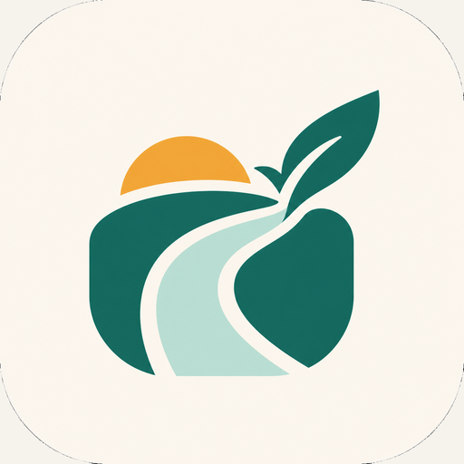

# Spendly Android listing draft

Prepared for review only; no store entry or application asset has been changed.

## Listing details

| Field | Value |
| --- | --- |
| Platform | Android |
| Base language | English |
| Name | Spendly |
| Subtitle | Smart Expense Tracking, Budgeting & Financial Insights |
| Category | Finance |

Google Play uses a **short description**, rather than a separate subtitle field.
The supplied subtitle can be used verbatim as the short description (54
characters, within the 80-character limit). The app name is 7 characters. See
[Google Play listing guidance](https://support.google.com/googleplay/android-developer/answer/13393723?hl=en).

## Description draft

Spendly helps Kenyan young adults understand their day-to-day finances in Kenyan
shillings (KES). Record income and expenses, organize spending, set budgets, and
review cash-flow summaries in an Android-first application.

- Track transactions through manual entry and supported CSV uploads.
- Review budgets, spending categories, and income/expense summaries.
- Explore weekly spending estimates based on recorded history and the configured
  forecasting model.
- Review unusual-spending alerts to spot entries that may deserve attention.
- Get rule-based financial recommendations informed by spending and budget patterns.

Spendly is an academic/pilot decision-support project. Forecasts depend on the
available history and model runtime; they are estimates, not guaranteed outcomes.
Unusual-spending alerts are not fraud findings, and recommendations are not
professional financial advice. Availability depends on the configured backend.

## Icon and provenance

- Listing file: [spendly-icon-512.png](spendly-icon-512.png).
- Source: [existing store icon](../../mobile/assets/branding/play_store_icon.png).
- Original branding: [application logo](../../mobile/assets/branding/spending_support_logo.png),
  also represented by the Android launcher resources under
  `mobile/android/app/src/main/res/`.
- Format: 512 × 512 PNG, 8-bit RGBA (32-bit), sRGB, with fully opaque alpha.
- Preparation: exported from the existing 512 × 512 asset with an opaque alpha
  channel and sRGB metadata. RGB pixels match the source exactly; there is no
  crop, recoloring, logo redesign, or launcher replacement.

The existing image includes a rounded-square background treatment. It is
preserved as requested. Review it against the destination store's current
masking/design rules before uploading; technical dimensions alone do not establish
store acceptance. See [Google Play icon specifications](https://developer.android.com/distribute/google-play/resources/icon-design-specifications).

## Before publishing

The owner must approve the listing, verify every claim against the actual release
build, and supply the store account/contact details, public privacy-policy URL,
data-safety/permission declarations, content rating, screenshots, and any other
required listing artwork. None of these details are inferred here.

The existing [tester APK guide](../live_deployment_and_tester_apk.md) describes
pilot signing and release limitations. This listing draft does not establish
Play Store readiness, native-device acceptance, or permission to publish.
