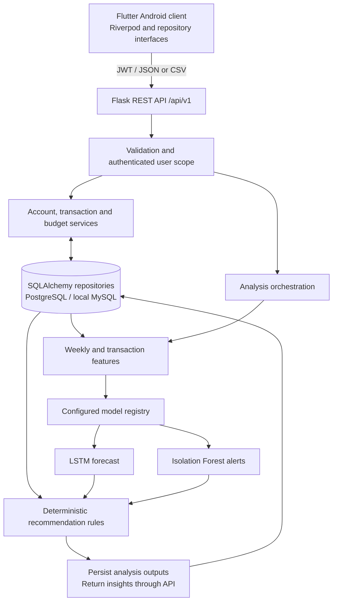

# System Architecture

This describes the source boundaries on `main`, not a fresh inspection of the
hosted service. The Android APK, backend deployment and research artifacts have
separate identities and release procedures.

## Service and data boundaries

- Flutter uses screens → repository interfaces → API repositories → API client.
  It contains no server-side training logic.
- Flask routes validate input and delegate to services. Financial ownership comes
  from authenticated identity; SQLAlchemy repositories scope access to that user.
- SQLAlchemy supports the PostgreSQL pilot and local MySQL Compose setup.
  Alembic manages schema changes; starting an existing container can apply
  migrations to its configured database.
- Configured model artifacts load at application startup when model loading is
  enabled. API analysis performs inference, never training.
- Analysis stores forecasts, alerts and recommendations. Missing history can
  produce an explicitly partial result rather than a fabricated forecast.
- The web administrator console uses separate session/CSRF controls, not mobile
  JWTs. Its privileged operations and audit trail are described in
  [administrator management](admin_management.md).

## Model/runtime selection

The [application factory](../backend/app/__init__.py) selects
[`SelectedModelRegistry`](../backend/app/services/selected_registry.py) when
`SELECTED_MODEL_ROOT` is configured; otherwise it uses the versioned
[`ModelRegistry`](../backend/app/services/model_registry.py).

| Path | Meaning |
|---|---|
| Selected V6 | Portable retained LSTM and single excess-view Isolation Forest; no TensorFlow or Linear Regression at serving time |
| Legacy V1 | Separate versioned schemas/artifacts and configured full/lightweight runtime; historical Linear Regression comparison belongs to this lineage |
| Research candidates | Evaluation evidence, not automatically active API models |

TensorFlow/Keras training and scikit-learn research happen separately from API
requests. The selected forecast estimates the **current Nairobi Monday–Sunday
week**, using eight complete preceding weeks and the user's history-completeness
confirmation. Isolation Forest returns unusual-spending prompts, not fraud labels.
The [recommendation rules](../services/recommendation_engine/rules.py) use recorded
spending, budgets and available analysis/review context; they do not execute
financial actions. See the [API workflow](api_guide.md#main-workflow).

The [Wasaa decision](wasaa_testing_and_model_decision.md) retains the original
total-spending LSTM and forest for the pilot. Final R3, reused validation, July
V1 and Wasaa transfer metrics belong to their own model/protocol records.
Frozen V2 research artifacts have a separate
[integration-readiness review](model_integration_readiness_v2.md); their presence
in the repository does not demonstrate deployment.

## Account and reporting behavior

- Registration and login expose Google sign-in when the matching client/server
  configuration is available; see [Google setup](google_sign_in_setup.md).
- Usernames are unique case-insensitively: 3–30 ASCII letters, numbers or
  underscores. Profile editing changes the username, not the email.
- New accounts complete or skip four account-scoped welcome screens once;
  Profile can replay them without resetting completion.
- Dashboard headline values are authenticated server aggregates, defaulting to
  the current Nairobi month. Other periods are Monday-based current week,
  rolling three months through today, current year and all time.
- Financial reporting uses Africa/Nairobi calendar boundaries; stored timestamps
  remain UTC. Historical V1 forecast actuals retain their original UTC weekly
  aggregation, while selected-V6 forecasts use Nairobi. Existing records are not
  rewritten to change their historical meaning.
- Empty periods, API failures and lifetime totals are distinct states.
- Optional SMS import has independent build/server capability and account consent
  gates. Its [contract](mpesa_sms_import.md) and the
  [1.4.1 migration record](release_1_4_1.md) are separate from source publication.

## Stored entities

Users, transactions, budgets, analysis runs, forecasts, anomaly alerts,
recommendations and model versions, with separate consent/import/audit records
for their supported workflows. See the [models](../backend/app/models/) and
[OpenAPI contract](openapi.yaml) for the implementation.

Use the [installation guide](INSTALLATION_AND_REPRODUCIBILITY.md) for a pinned
local reproduction and the [branch workflow](git_workflow.md) for deployment
boundaries. A source merge does not update an installed APK or hosted database.
